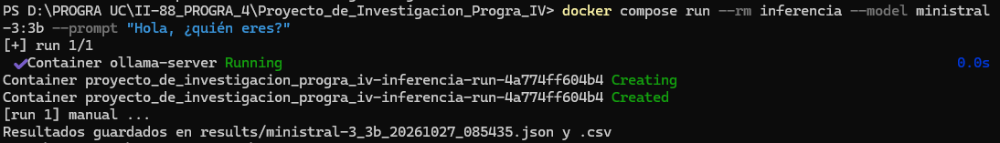

# Proyecto de Investigación: Mistral AI en local

Programación IV – Lenguajes de Cuarta Generación.
Autor(es): <nombre(s)>

Ejecución local de <Ministral 3 XB Q4_K_M> con Ollama, script propio de
inferencia en Python, contenedor Docker y análisis de desempeño.

## Estructura

```
├── README.md
├── requirements.txt
├── Dockerfile
├── .dockerignore
├── docker-compose.yml
├── src/            (inference.py, monitor.py, analyze.py)
├── prompts/suite.json
├── results/        (CSV/JSON de las corridas)
└── docs/           (capturas y logs)
```

## Requisitos

- Python 3.10 o superior
- Ollama (https://ollama.com/download)
- Docker Desktop y Docker Compose
- <RAM mínima y espacio en disco que necesitas>

## 1. Descarga del modelo

```bash
ollama pull <etiqueta>
```

El modelo no está en el repositorio (ver `.gitignore`).

## 2. Ejecución nativa

```bash
pip install -r requirements.txt
python src/inference.py --model <etiqueta> --prompt "Hola"
python src/inference.py --model <etiqueta> --prompts-file prompts/suite.json --temperature 0.2 --max-tokens 400 --runs 3
```

Argumentos: `--model`, `--prompt` o `--prompts-file`, `--temperature`,
`--max-tokens`, `--runs`, `--output-dir`. La variable `OLLAMA_HOST`
cambia el servidor (por defecto `http://localhost:11434`).

## 3. Ejecución con Docker

```bash
docker compose up -d ollama
docker compose exec ollama ollama pull <etiqueta>
docker compose run --rm inferencia --model <etiqueta> --prompts-file prompts/suite.json --temperature 0.2 --max-tokens 400
```

El modelo vive en un volumen de Docker y no dentro de la imagen, porque
pesa varios GB, evita reconstruir la imagen al cambiar de modelo y se
descarga una sola vez.

## 4. Análisis de métricas

```bash
pip install pandas matplotlib psutil
python src/analyze.py --config nativo=results/nativo_3runs.json --config docker=results/docker_3runs.json
```

## Ejemplo de salida

```
[run 1] gen_01 ...
Resultados guardados en results/<archivo>.json y .csv
```



## Problemas comunes

Ver tabla en el informe (sección 7 de la parte práctica).

## Declaración de uso de IA

| Herramienta            | Para qué se usó                                                                                                                               | Partes donde se usó |
| :--------------------- | :-------------------------------------------------------------------------------------------------------------------------------------------- | :------------------ |
| **Claude (Anthropic)** | Generar el plan del proyecto, ideas para prompts, ayuda con comandos en terminal y guía de ejecución de la parte práctica de la investigación | prompts/suite.json  |
| **Gemini (Google)**    | Análisis de costos y comparativa de despliegue: Local vs. API Mistral vs. Nube GPU (AWS)                                                      | docs/costos.md      |
